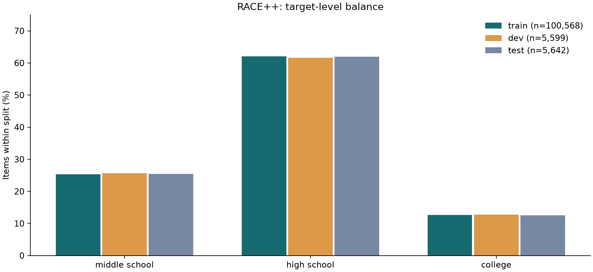
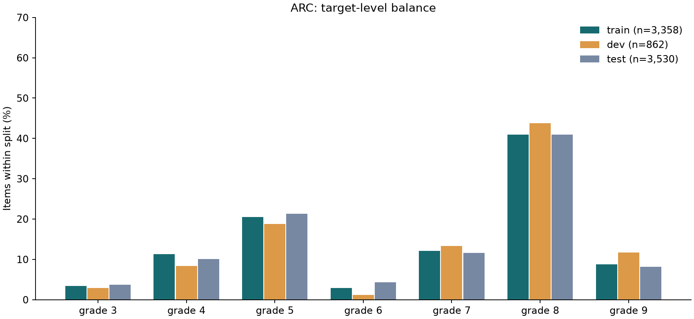
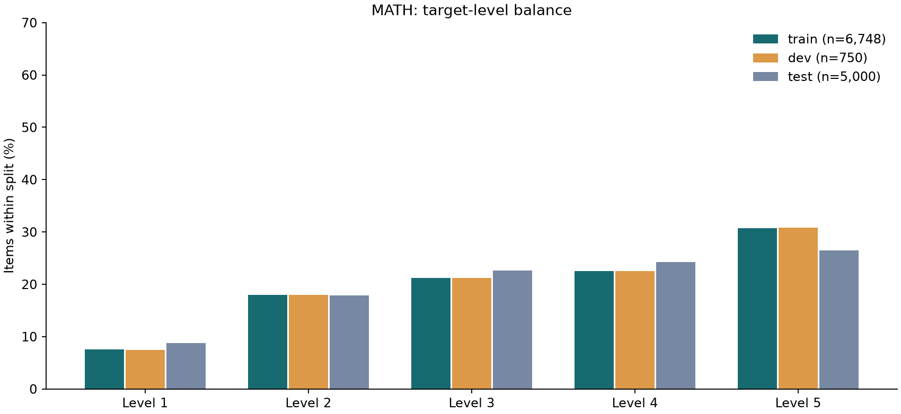
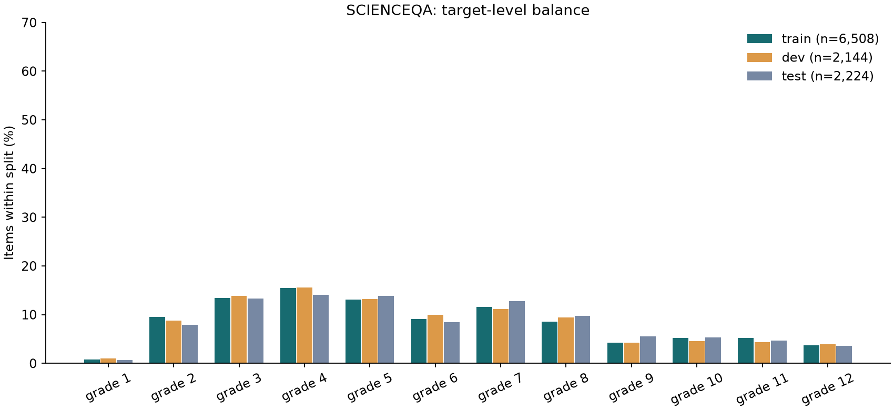

# Dataset cards and checks

中文版：[datasets.zh-CN.md](datasets.zh-CN.md)

**Owner:** Wenyue. Checked on 12 November 2026 using the unmodified adapters from base commit `6228662`. The four datasets reproduce all 17 saved fingerprints, including derived subsets. All 12 primary split counts match `docs/design.md`. No count mismatch was found.

The labels represent **target levels**, not difficulty calibrated from student responses. This review does not change frozen splits or labels. Aggregate data and four class-balance figures are in `results/data_checks/`; no raw questions are committed.

## Reproduce

```bash
pip install -r requirements.txt -r notebooks/requirements-b.txt
python -m levellens.data.prepare
python notebooks/data_checks.py
python -m pytest -q
```

Run `notebooks/data_checks.ipynb` for the same checks with displayed tables and figures. No model weights or GPU are needed. `LEVELLENS_DATA` and `LEVELLENS_RESULTS` are honoured.

## Definitions

- Counts use the primary train, dev and test splits. `test_1k` and `train_balanced` are intentional subsets and excluded from leakage comparisons.
- Required fields, nulls, empty inputs, option/answer validity, level names and grade mappings are checked before analysis. Each primary split has ten schema columns. Null passages are expected outside RACE++.
- Question length counts whitespace tokens in `question`. Model-input length counts them in `text`. These are not BERT token counts. Full mean, median, 95th percentile, minimum and maximum in words and characters are retained by split and level in `summary.json`.
- Stem repeats compare exact stored `question` strings. Input repeats compare exact stored `text`, after the adapter's whitespace normalisation. A duplicate group is a distinct repeated string; extra rows equal group size minus one. No near-duplicate detection is claimed.
- A conflicting-level group has more than one target label. Different omitted passages can explain a conflict, so it is not automatically label noise.
- Ten training inputs per level were selected deterministically with sample seed 38: 270 inputs across 27 levels. The observations in the tables below are a preliminary content review, and Wenyue's item-by-item confirmation of them is still pending. The sample is not a statistically representative error-rate estimate. Exact sample IDs and observations are retained in `sample_review.json`.


## RACE++

**Labels and purpose.** English examination reading; source stages middle school, high school and college. Labels 0–2 preserve this order.

**Preparation and input.** The adapters combine `ehovy/race` middle/high with `tasksource/race-c`, preserving source splits. Input is the stem and four lettered options; the passage is stored but excluded. Exact passage strings have no overlap across primary splits. Multiple questions per passage are expected.

**Source and licence.** [RACE card](https://huggingface.co/datasets/ehovy/race/blob/main/README.md), [RACE-C card](https://huggingface.co/datasets/tasksource/race-c/blob/main/README.md), [RACE paper](https://aclanthology.org/D17-1082/), [RACE-C paper](https://proceedings.mlr.press/v101/liang19a.html). RACE specifies non-commercial research. No licence is stated in the inspected RACE-C card; this is unresolved, not a permissive licence.

**Pinned source.** `ehovy/race@2fec9fd81f1dc971569a9b729c43f2f0e6436637`; `tasksource/race-c@99b95125875f1ef0e47f89801cb435d14911fffa`

### Counts per level

| Target level | Train | Dev | Test |
| --- | --- | --- | --- |
| middle school | 25421 | 1436 | 1436 |
| high school | 62445 | 3451 | 3498 |
| college | 12702 | 712 | 708 |
| Total | 100568 | 5599 | 5642 |




Caption: percentage of each target level within each frozen split; denominators are shown in the legend. Source: `summary.json`, not a model run.

### Length by level and split

| Split | Target level | Mean stem words | Mean input words | Median input words | Input p95 |
| --- | --- | --- | --- | --- | --- |
| train | middle school | 9.05 | 30.68 | 29.0 | 53.0 |
| train | high school | 10.4 | 39.34 | 39.0 | 60.0 |
| train | college | 11.81 | 42.85 | 42.0 | 72.0 |
| dev | middle school | 8.94 | 30.8 | 28.0 | 53.0 |
| dev | high school | 10.24 | 39.01 | 39.0 | 59.0 |
| dev | college | 11.73 | 42.97 | 43.0 | 73.0 |
| test | middle school | 8.94 | 30.93 | 29.0 | 53.25 |
| test | high school | 10.42 | 39.61 | 40.0 | 60.15 |
| test | college | 11.7 | 43.03 | 42.0 | 70.65 |


### Exact repeats

| Field | Split | Repeated groups | Extra rows | Conflicting-level groups |
| --- | --- | --- | --- | --- |
| question | train | 4253 | 17025 | 1508 |
| question | dev | 130 | 413 | 57 |
| question | test | 142 | 469 | 70 |
| text | train | 1275 | 1319 | 810 |
| text | dev | 2 | 2 | 2 |
| text | test | 5 | 5 | 3 |


| Field | Split pair | Shared strings | Left rows | Right rows | Pairs | Conflicting groups |
| --- | --- | --- | --- | --- | --- | --- |
| question | train:dev | 773 | 10672 | 1180 | 61427 | 352 |
| question | train:test | 729 | 11001 | 1190 | 67482 | 356 |
| question | dev:test | 221 | 593 | 633 | 3439 | 110 |
| text | train:dev | 146 | 154 | 146 | 154 | 100 |
| text | train:test | 156 | 169 | 156 | 169 | 96 |
| text | dev:test | 11 | 11 | 11 | 11 | 9 |


The train/test comparison has 156 shared complete input strings, touching 156 test rows, with 96 groups carrying different levels across the two splits. The passages have zero exact cross-split overlap. This combination points to repeated context-free inputs, not evidence of passage leakage. Repeated identical answer options occur in 55/5/3 train/dev/test items.


### Ten examples per level: preliminary observations

| Target level | Inputs sampled | Observation |
| --- | --- | --- |
| middle school | 10 | The ten inputs include retrieval, weather expressions, main ideas and negative questions. Several refer to an omitted passage; a short stem does not mean a low reasoning demand. |
| high school | 10 | The ten inputs mix retrieval, inference and main-idea tasks. high23964-q1 contains inconsistent telephone-number typography, and high23371-q4 contains the merged token Selfprovides. |
| college | 10 | The ten inputs include referents, inference and paragraph-level questions. college447-q4 has identical B and C options and the typo sue. This is an item-format issue, not evidence that the college label is wrong. |


## ARC with school grades

**Labels and purpose.** Science examination items; school grades 3–9 map to levels 0–6. Easy/Challenge is not the prediction label.

**Preparation and input.** The original AI2 CSV files supply schoolGrade. The six Easy/Challenge source splits are combined, keeping multiple-choice, no-diagram items parsed into exactly four options. Main training retains all items. `train_balanced` caps grades 5 and 8 at 500 each, producing 2,293 items; it is not perfectly balanced. Test and dev are unchanged.

**Source and licence.** [Original AI2 archive](https://ai2-public-datasets.s3.amazonaws.com/arc/ARC-V1-Feb2018.zip), [official AI2 card](https://huggingface.co/datasets/allenai/ai2_arc), [paper](https://arxiv.org/abs/1803.05457). Licence: CC BY-SA 4.0 according to the official card. The Hugging Face rows do not supply the grade field used here.

**Pinned source.** `ARC-V1-Feb2018.zip`; filtered processed splits verified against the repository manifest

### Counts per level

| Target level | Train | Dev | Test |
| --- | --- | --- | --- |
| grade 3 | 115 | 25 | 130 |
| grade 4 | 379 | 72 | 355 |
| grade 5 | 690 | 162 | 751 |
| grade 6 | 99 | 10 | 154 |
| grade 7 | 406 | 115 | 408 |
| grade 8 | 1375 | 377 | 1444 |
| grade 9 | 294 | 101 | 288 |
| Total | 3358 | 862 | 3530 |




Caption: percentage of each target level within each frozen split; denominators are shown in the legend. Source: `summary.json`, not a model run.

### Length by level and split

| Split | Target level | Mean stem words | Mean input words | Median input words | Input p95 |
| --- | --- | --- | --- | --- | --- |
| train | grade 3 | 14.54 | 32.09 | 30.0 | 59.0 |
| train | grade 4 | 16.59 | 35.35 | 32.0 | 65.1 |
| train | grade 5 | 19.58 | 39.52 | 36.0 | 71.0 |
| train | grade 6 | 14.57 | 34.02 | 30.0 | 64.1 |
| train | grade 7 | 21.23 | 43.41 | 41.5 | 78.0 |
| train | grade 8 | 20.38 | 41.33 | 38.0 | 76.0 |
| train | grade 9 | 25.5 | 46.95 | 45.0 | 82.7 |
| dev | grade 3 | 12.52 | 30.08 | 27.0 | 50.0 |
| dev | grade 4 | 18.57 | 35.08 | 33.5 | 63.35 |
| dev | grade 5 | 20.46 | 42.48 | 38.0 | 78.85 |
| dev | grade 6 | 18.6 | 34.1 | 31.0 | 57.1 |
| dev | grade 7 | 22.66 | 42.85 | 39.0 | 76.3 |
| dev | grade 8 | 19.76 | 40.08 | 37.0 | 70.0 |
| dev | grade 9 | 26.99 | 49.32 | 45.0 | 87.0 |
| test | grade 3 | 14.71 | 33.42 | 32.0 | 56.1 |
| test | grade 4 | 17.06 | 36.8 | 32.0 | 66.9 |
| test | grade 5 | 18.73 | 38.49 | 35.0 | 74.0 |
| test | grade 6 | 17.71 | 36.99 | 34.0 | 68.0 |
| test | grade 7 | 21.84 | 43.64 | 40.0 | 81.65 |
| test | grade 8 | 21.47 | 42.16 | 38.0 | 79.0 |
| test | grade 9 | 27.7 | 50.36 | 48.0 | 84.65 |


### Exact repeats

| Field | Split | Repeated groups | Extra rows | Conflicting-level groups |
| --- | --- | --- | --- | --- |
| question | train | 8 | 9 | 4 |
| question | dev | 0 | 0 | 0 |
| question | test | 8 | 8 | 2 |
| text | train | 1 | 1 | 1 |
| text | dev | 0 | 0 | 0 |
| text | test | 0 | 0 | 0 |


| Field | Split pair | Shared strings | Left rows | Right rows | Pairs | Conflicting groups |
| --- | --- | --- | --- | --- | --- | --- |
| question | train:dev | 2 | 2 | 2 | 2 | 1 |
| question | train:test | 15 | 16 | 16 | 17 | 3 |
| question | dev:test | 2 | 2 | 2 | 2 | 1 |
| text | train:dev | 0 | 0 | 0 | 0 | 0 |
| text | train:test | 2 | 2 | 2 | 2 | 0 |
| text | dev:test | 0 | 0 | 0 | 0 | 0 |


Grade 8 contributes 1,375 of 3,358 training items. Two complete input strings are shared between train and test. One training input group has different grade labels. Class-weighted evaluation and per-grade recall remain necessary; these observations do not authorise changes to the frozen splits.


### Ten examples per level: preliminary observations

| Target level | Inputs sampled | Observation |
| --- | --- | --- |
| grade 3 | 10 | The ten examples cover life cycles, resources, friction and land formation. Terms such as metamorphosis coexist with simple factual recall; grade is a curriculum label. |
| grade 4 | 10 | The ten examples range from identifying a herbivore to orbital explanations and ecological effects. No missing diagram reference was apparent in these inputs. |
| grade 5 | 10 | The ten examples cover chemical changes, heat, fuels and lab safety. MCAS_2005_5_28 contains an isolated 28 in the stem, consistent with a source formatting artefact. |
| grade 6 | 10 | The ten examples mix gravity, optics, sampling and recall. The Edison item uses a simplified historical attribution; no target-grade relabelling follows from that observation. |
| grade 7 | 10 | The ten examples cover cells, heat, succession, minerals and energy transfer. Negation in Mercury_7106400 matters to interpreting the question. |
| grade 8 | 10 | The ten examples include experiment design, Earth layers, chemistry and simple cell recall. A grade-8 item can require less text than a grade-3 item. |
| grade 9 | 10 | The ten examples cover gene expression, hormones, repeated trials, evaporation and storms. The sampled inputs are readable; their grade labels are not empirically calibrated difficulty scores. |


## MATH

**Labels and purpose.** Competition mathematics with five ordered levels 1–5 mapped to indices 0–4. Level is distinct from school grade and problem type.

**Preparation and input.** Seven subject configurations are combined. Two training-pool rows with Level ? are dropped, leaving 7,498. The adapter holds out 750 for dev by a fixed hash, stratified by level and type; train has 6,748. The original 5,000-item test split is retained. Input is problem text only; solutions stay in meta and are not model input. Inline answer options and Asymptote markup can still occur inside problem text.

**Source and licence.** [Mirror](https://huggingface.co/datasets/EleutherAI/hendrycks_math), [original repository and MIT licence](https://github.com/hendrycks/math), [NeurIPS paper](https://datasets-benchmarks-proceedings.neurips.cc/paper_files/paper/2021/file/be83ab3ecd0db773eb2dc1b0a17836a1-Paper-round2.pdf). Dataset release: MIT; original problem provenance remains relevant.

**Pinned source.** `EleutherAI/hendrycks_math@21a5633873b6a120296cce3e2df9d5550074f4a3`; dev seed 0

### Counts per level

| Target level | Train | Dev | Test |
| --- | --- | --- | --- |
| Level 1 | 508 | 56 | 437 |
| Level 2 | 1213 | 135 | 894 |
| Level 3 | 1433 | 159 | 1131 |
| Level 4 | 1521 | 169 | 1214 |
| Level 5 | 2073 | 231 | 1324 |
| Total | 6748 | 750 | 5000 |




Caption: percentage of each target level within each frozen split; denominators are shown in the legend. Source: `summary.json`, not a model run.

### Length by level and split

| Split | Target level | Mean stem words | Mean input words | Median input words | Input p95 |
| --- | --- | --- | --- | --- | --- |
| train | Level 1 | 20.92 | 20.92 | 16.0 | 52.0 |
| train | Level 2 | 24.44 | 24.44 | 20.0 | 57.0 |
| train | Level 3 | 28.66 | 28.66 | 23.0 | 70.0 |
| train | Level 4 | 32.69 | 32.69 | 27.0 | 75.0 |
| train | Level 5 | 44.55 | 44.55 | 37.0 | 102.0 |
| dev | Level 1 | 22.93 | 22.93 | 12.5 | 64.0 |
| dev | Level 2 | 26.13 | 26.13 | 21.0 | 57.5 |
| dev | Level 3 | 27.76 | 27.76 | 22.0 | 68.1 |
| dev | Level 4 | 30.37 | 30.37 | 26.0 | 66.0 |
| dev | Level 5 | 42.1 | 42.1 | 37.0 | 91.0 |
| test | Level 1 | 18.97 | 18.97 | 14.0 | 52.0 |
| test | Level 2 | 23.82 | 23.82 | 20.0 | 56.35 |
| test | Level 3 | 27.4 | 27.4 | 23.0 | 64.0 |
| test | Level 4 | 33.0 | 33.0 | 28.0 | 76.0 |
| test | Level 5 | 39.75 | 39.75 | 34.0 | 87.85 |


### Exact repeats

| Field | Split | Repeated groups | Extra rows | Conflicting-level groups |
| --- | --- | --- | --- | --- |
| question | train | 0 | 0 | 0 |
| question | dev | 0 | 0 | 0 |
| question | test | 0 | 0 | 0 |
| text | train | 1 | 1 | 0 |
| text | dev | 0 | 0 | 0 |
| text | test | 0 | 0 | 0 |


| Field | Split pair | Shared strings | Left rows | Right rows | Pairs | Conflicting groups |
| --- | --- | --- | --- | --- | --- | --- |
| question | train:dev | 0 | 0 | 0 | 0 | 0 |
| question | train:test | 0 | 0 | 0 | 0 | 0 |
| question | dev:test | 0 | 0 | 0 | 0 | 0 |
| text | train:dev | 0 | 0 | 0 | 0 | 0 |
| text | train:test | 0 | 0 | 0 | 0 | 0 |
| text | dev:test | 1 | 1 | 1 | 1 | 1 |


There are no exact raw-stem duplicates. Whitespace normalisation makes one training input pair identical and one dev/test input pair identical; the latter has different levels. Asymptote markup occurs in 643/64/419 train/dev/test items. Counting that code as ordinary text can affect length-based features.


### Ten examples per level: preliminary observations

| Target level | Inputs sampled | Observation |
| --- | --- | --- |
| Level 1 | 10 | The ten problems include arithmetic, ratios and trigonometry. Level 1 is a competition-relative label and includes precalculus content, so it is not school grade 1. |
| Level 2 | 10 | The ten problems mix identities, sequences, operations and probability. prealgebra-0455 asks for the smallest positive multiple of 32; perceived simplicity alone is insufficient to declare label noise. |
| Level 3 | 10 | The ten problems include base-12 arithmetic, constrained arrangements, geometry and routine algebra. Length alone does not separate these from the other levels. |
| Level 4 | 10 | The ten problems include parameter constraints, probability and arithmetic. prealgebra-0830 contains Asymptote drawing code; the input contains code rather than a rendered diagram. |
| Level 5 | 10 | The ten problems range from Vieta relations to infinite series and geometry. prealgebra-0563 contains drawing code. number_theory-0664 and geometry-0579 embed multiple-choice options in the problem despite the empty structured options field. |


## ScienceQA without images

**Labels and purpose.** Source grades 1–12 map to indices 0–11. The set includes natural, social and language science and is reserved for extrapolation, not training in this project.

**Preparation and input.** Drop every item whose image field is non-null. Original split sizes 12,726/4,241/4,241 become 6,508/2,144/2,224. The model sees question and choices. The textual hint is kept in meta but excluded from input; no-image does not mean context-free. Grade indices differ from ARC: convert ARC index to grade by adding 3 and ScienceQA index by adding 1 before comparison.

**Source and licence.** [Mirror](https://huggingface.co/datasets/derek-thomas/ScienceQA), [original repository](https://github.com/lupantech/ScienceQA), [original data licence](https://raw.githubusercontent.com/lupantech/ScienceQA/main/LICENSE-DATA). The original data licence is CC BY-NC-SA 4.0. The mirror's CC BY-SA 4.0 tag conflicts with it; record the conflict and follow the original release restriction for this coursework. The code's MIT licence is separate.

**Pinned source.** `derek-thomas/ScienceQA@f18b0a70359ebfb41f658fd564208d0355b013f4`

### Counts per level

| Target level | Train | Dev | Test |
| --- | --- | --- | --- |
| grade 1 | 50 | 22 | 15 |
| grade 2 | 621 | 188 | 176 |
| grade 3 | 875 | 298 | 296 |
| grade 4 | 1008 | 333 | 312 |
| grade 5 | 850 | 282 | 308 |
| grade 6 | 591 | 213 | 188 |
| grade 7 | 757 | 239 | 285 |
| grade 8 | 557 | 202 | 217 |
| grade 9 | 279 | 90 | 122 |
| grade 10 | 340 | 98 | 119 |
| grade 11 | 340 | 94 | 105 |
| grade 12 | 240 | 85 | 81 |
| Total | 6508 | 2144 | 2224 |




Caption: percentage of each target level within each frozen split; denominators are shown in the legend. Source: `summary.json`, not a model run.

### Length by level and split

| Split | Target level | Mean stem words | Mean input words | Median input words | Input p95 |
| --- | --- | --- | --- | --- | --- |
| train | grade 1 | 11.26 | 17.44 | 15.0 | 28.55 |
| train | grade 2 | 9.98 | 18.35 | 15.0 | 34.0 |
| train | grade 3 | 10.28 | 24.03 | 22.0 | 41.0 |
| train | grade 4 | 11.32 | 26.62 | 22.0 | 54.0 |
| train | grade 5 | 9.71 | 27.04 | 20.0 | 70.65 |
| train | grade 6 | 15.61 | 32.98 | 26.0 | 66.0 |
| train | grade 7 | 15.72 | 35.03 | 35.0 | 65.2 |
| train | grade 8 | 17.18 | 35.59 | 34.0 | 63.2 |
| train | grade 9 | 20.76 | 38.71 | 33.0 | 74.0 |
| train | grade 10 | 23.84 | 43.83 | 39.0 | 78.0 |
| train | grade 11 | 29.36 | 49.34 | 40.0 | 112.05 |
| train | grade 12 | 25.76 | 42.69 | 37.5 | 75.0 |
| dev | grade 1 | 11.27 | 17.64 | 15.0 | 27.0 |
| dev | grade 2 | 10.46 | 18.77 | 16.5 | 34.0 |
| dev | grade 3 | 9.79 | 23.59 | 22.0 | 41.0 |
| dev | grade 4 | 10.99 | 27.68 | 22.0 | 56.0 |
| dev | grade 5 | 10.31 | 26.48 | 21.0 | 61.0 |
| dev | grade 6 | 13.15 | 30.52 | 25.0 | 57.0 |
| dev | grade 7 | 14.63 | 32.89 | 31.0 | 63.2 |
| dev | grade 8 | 17.4 | 35.1 | 34.0 | 64.0 |
| dev | grade 9 | 19.84 | 37.97 | 32.0 | 72.0 |
| dev | grade 10 | 21.17 | 41.78 | 38.0 | 76.0 |
| dev | grade 11 | 24.06 | 46.6 | 39.0 | 80.4 |
| dev | grade 12 | 23.75 | 39.41 | 36.0 | 68.0 |
| test | grade 1 | 10.67 | 17.13 | 15.0 | 28.6 |
| test | grade 2 | 9.73 | 17.86 | 15.0 | 34.0 |
| test | grade 3 | 9.91 | 22.9 | 22.0 | 41.0 |
| test | grade 4 | 11.6 | 28.05 | 22.0 | 54.0 |
| test | grade 5 | 9.99 | 27.3 | 21.5 | 63.0 |
| test | grade 6 | 15.63 | 31.55 | 25.0 | 63.65 |
| test | grade 7 | 15.12 | 34.42 | 34.0 | 63.0 |
| test | grade 8 | 17.35 | 34.59 | 31.0 | 64.2 |
| test | grade 9 | 21.17 | 39.55 | 34.5 | 74.0 |
| test | grade 10 | 23.17 | 44.15 | 39.0 | 82.2 |
| test | grade 11 | 28.83 | 50.19 | 41.0 | 94.4 |
| test | grade 12 | 24.2 | 39.86 | 36.0 | 73.0 |


### Exact repeats

| Field | Split | Repeated groups | Extra rows | Conflicting-level groups |
| --- | --- | --- | --- | --- |
| question | train | 371 | 2293 | 201 |
| question | dev | 150 | 628 | 85 |
| question | test | 157 | 608 | 92 |
| text | train | 4 | 4 | 0 |
| text | dev | 1 | 1 | 0 |
| text | test | 1 | 1 | 0 |


| Field | Split pair | Shared strings | Left rows | Right rows | Pairs | Conflicting groups |
| --- | --- | --- | --- | --- | --- | --- |
| question | train:dev | 286 | 2339 | 898 | 29794 | 173 |
| question | train:test | 292 | 2336 | 889 | 28516 | 185 |
| question | dev:test | 198 | 786 | 757 | 9717 | 127 |
| text | train:dev | 2 | 2 | 2 | 2 | 0 |
| text | train:test | 5 | 5 | 5 | 5 | 0 |
| text | dev:test | 2 | 2 | 2 | 2 | 1 |


The test set contains 1,728 items in grades 3–9 and 496 outside that range. Its subjects are 1,043 natural science, 1,056 language science and 125 social science. Every test item in grades 9–12 is language science; upper-grade extrapolation is confounded with subject shift. There are 2,135/764/789 nonempty hints in train/dev/test, excluded by the current input format.

| Test grade | Natural science | Language science | Social science |
| --- | --- | --- | --- |
| 1 | 0 | 15 | 0 |
| 2 | 91 | 67 | 18 |
| 3 | 178 | 113 | 5 |
| 4 | 169 | 101 | 42 |
| 5 | 190 | 76 | 42 |
| 6 | 107 | 75 | 6 |
| 7 | 185 | 95 | 5 |
| 8 | 123 | 87 | 7 |
| 9 | 0 | 122 | 0 |
| 10 | 0 | 119 | 0 |
| 11 | 0 | 105 | 0 |
| 12 | 0 | 81 | 0 |


### Ten examples per level: preliminary observations

| Target level | Inputs sampled | Observation |
| --- | --- | --- |
| grade 1 | 10 | All ten sampled grade-1 items are language science riddles or rhyme questions, illustrating a subject shift relative to ARC. |
| grade 2 | 10 | The ten items mix measurement, grammar and goods/services. Capitalisation can be the information separating answer options. |
| grade 3 | 10 | The ten items mix inherited traits, physical changes, civics and letter writing. Some trait questions refer to source context; hints are preserved separately. |
| grade 4 | 10 | The ten items mix minerals, cell biology, measurement and grammar. The label denotes a source grade, not a common science-content standard. |
| grade 5 | 10 | The ten items include unit selection, animal classification and thermal energy. The ball-temperature item relies on comparable objects; its hint should be inspected for the stated assumptions. |
| grade 6 | 10 | 05785 requires a list of supplies and 06206 requires genetic context. Both are stored in hint but absent from text; the no-image filter does not guarantee a self-contained input. |
| grade 7 | 10 | The ten examples mix grammar, units, traits and force balance. 02220 refers to forces described outside the model input; missing hint context must be disclosed. |
| grade 8 | 10 | 00814 and 00383 depend on supplies, while 12554 depends on a motion description. Several others are language rather than natural-science questions. |
| grade 9 | 10 | All ten sampled grade-9 items are language science, including allusion, irony and formality. This subject shift can confound grade extrapolation. |
| grade 10 | 10 | All ten sampled grade-10 items are language science. The sample contains two near-template variants of a pronoun-reference question; near-duplicate counting is outside B1 scope. |
| grade 11 | 10 | All ten sampled grade-11 items are language science, including style, fallacies and citations. Several prompts are substantially longer than simple grade-7 science questions. |
| grade 12 | 10 | All ten sampled grade-12 items are language science, including grammar, rhetoric and fallacies. High-grade transfer should not be described as science-only generalisation. |


## Implications for the team

A should review the RACE++ input mismatch documented in [related_work.md](related_work.md), the duplicate-input counts, and ScienceQA hint/subject caveats before interpreting final performance. B preserves the current splits and records these findings. The RACE++ input difference is also stated in [design.md](design.md). The final-model audit remains [pending](audit.md).

The data-review findings are descriptive. No labels were re-assigned, no performance gains were inferred, and no result from a sampled content review is presented as a student-calibrated difficulty measurement.
