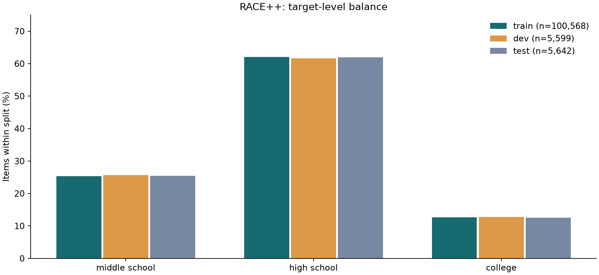
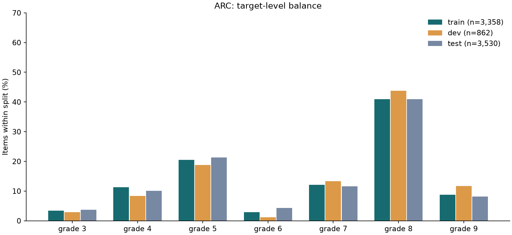
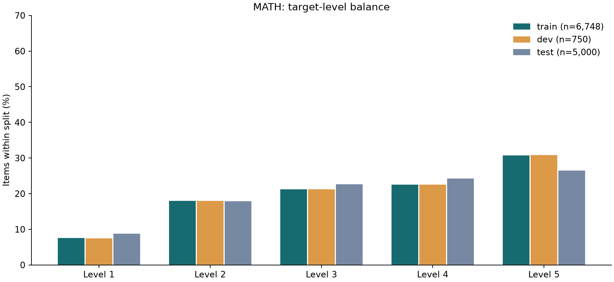
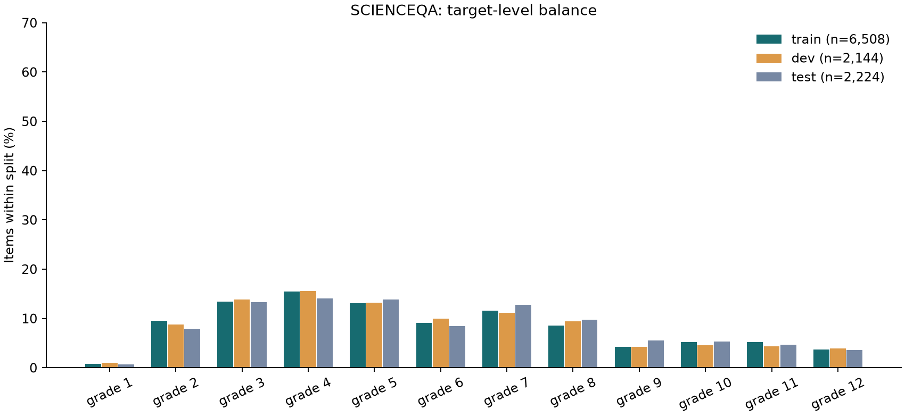

# 数据集卡片和数据检查

English: [datasets.md](datasets.md)

**负责人：** Wenyue。2026 年 11 月 12 日检查，用的是基准提交 `6228662` 里没有改动过的适配器。四个数据集复现了全部 17 个已保存的指纹，包括派生子集。12 个主划分的题数全部和 `docs/design.md` 一致。没有发现题数不一致。

标签表示的是**目标等级**，不是根据学生作答校准出来的难度。这次检查不改动冻结的划分和标签。汇总数据和四张类别分布图在 `results/data_checks/` 里，原始题目没有提交。

## 复现

```bash
pip install -r requirements.txt -r notebooks/requirements-b.txt
python -m levellens.data.prepare
python notebooks/data_checks.py
python -m pytest -q
```

运行 `notebooks/data_checks.ipynb` 可以做同样的检查，并显示表格和图。不需要模型权重，也不需要 GPU。`LEVELLENS_DATA` 和 `LEVELLENS_RESULTS` 两个环境变量会生效。

## 定义

- 题数按主要的训练、验证、测试三个划分统计。`test_1k` 和 `train_balanced` 是有意取出的子集，不参加泄漏比较。
- 分析之前先检查必需字段、空值、空输入、选项和答案是否有效、等级名称以及年级映射。每个主划分有十个字段列。RACE++ 之外的数据集文章字段为空是正常的。
- 题干长度是 `question` 里按空白切分的词数。模型输入长度是 `text` 里按空白切分的词数。它们不是 BERT 的 token 数。按划分和等级统计的均值、中位数、第 95 百分位数、最小值和最大值（词数和字符数）完整保存在 `summary.json` 里。
- 题干重复比较的是保存下来的 `question` 字符串是否完全相同。输入重复比较的是适配器规范化空白之后保存的 `text` 是否完全相同。一个重复组是一条出现多次的字符串，多出的行数等于组的大小减一。这里没有做近似重复的检测。
- 等级冲突组是指同一条字符串带有不止一个目标等级。被省略的文章不同可以解释这种冲突，所以它不一定是标签噪声。
- 每个等级按确定性规则抽取十条训练输入，抽样种子是 38，27 个等级共 270 条。下面各表里的观察是初步的内容检查，Wenyue 的逐题确认还没有完成。这个样本不能用来估计有统计代表性的错误率。具体的样本 ID 和观察保存在 `sample_review.json` 里。


## RACE++

**标签和用途。** 英语考试的阅读题，来源阶段是初中、高中和大学。标签 0–2 保持这个顺序。

**准备和输入。** 适配器把 `ehovy/race` 的 middle 和 high 两部分与 `tasksource/race-c` 合并，保留来源的划分。输入是题干和四个带字母的选项，文章保存下来但不进入输入。完全相同的文章字符串在主划分之间没有重叠。同一篇文章对应多道题是正常的。

**来源和许可证。** [RACE 数据卡](https://huggingface.co/datasets/ehovy/race/blob/main/README.md)、[RACE-C 数据卡](https://huggingface.co/datasets/tasksource/race-c/blob/main/README.md)、[RACE 论文](https://aclanthology.org/D17-1082/)、[RACE-C 论文](https://proceedings.mlr.press/v101/liang19a.html)。RACE 规定仅限非商业研究。所查看的 RACE-C 数据卡没有写许可证，这一点没有解决，不能当作宽松许可证。

**固定的来源版本。** `ehovy/race@2fec9fd81f1dc971569a9b729c43f2f0e6436637`；`tasksource/race-c@99b95125875f1ef0e47f89801cb435d14911fffa`

### 各等级题数

| 目标等级 | 训练 | 验证 | 测试 |
| --- | --- | --- | --- |
| 初中 | 25421 | 1436 | 1436 |
| 高中 | 62445 | 3451 | 3498 |
| 大学 | 12702 | 712 | 708 |
| 合计 | 100568 | 5599 | 5642 |




图注：每个冻结划分内各目标等级所占的百分比，分母写在图例里。数据来自 `summary.json`，不是模型运行的结果。

### 各等级、各划分的长度

| 划分 | 目标等级 | 题干平均词数 | 输入平均词数 | 输入词数中位数 | 输入 p95 |
| --- | --- | --- | --- | --- | --- |
| 训练 | 初中 | 9.05 | 30.68 | 29.0 | 53.0 |
| 训练 | 高中 | 10.4 | 39.34 | 39.0 | 60.0 |
| 训练 | 大学 | 11.81 | 42.85 | 42.0 | 72.0 |
| 验证 | 初中 | 8.94 | 30.8 | 28.0 | 53.0 |
| 验证 | 高中 | 10.24 | 39.01 | 39.0 | 59.0 |
| 验证 | 大学 | 11.73 | 42.97 | 43.0 | 73.0 |
| 测试 | 初中 | 8.94 | 30.93 | 29.0 | 53.25 |
| 测试 | 高中 | 10.42 | 39.61 | 40.0 | 60.15 |
| 测试 | 大学 | 11.7 | 43.03 | 42.0 | 70.65 |


### 完全重复

| 字段 | 划分 | 重复组数 | 多出的行数 | 等级冲突组数 |
| --- | --- | --- | --- | --- |
| question | 训练 | 4253 | 17025 | 1508 |
| question | 验证 | 130 | 413 | 57 |
| question | 测试 | 142 | 469 | 70 |
| text | 训练 | 1275 | 1319 | 810 |
| text | 验证 | 2 | 2 | 2 |
| text | 测试 | 5 | 5 | 3 |


| 字段 | 划分对 | 共有字符串数 | 左侧行数 | 右侧行数 | 配对数 | 冲突组数 |
| --- | --- | --- | --- | --- | --- | --- |
| question | 训练–验证 | 773 | 10672 | 1180 | 61427 | 352 |
| question | 训练–测试 | 729 | 11001 | 1190 | 67482 | 356 |
| question | 验证–测试 | 221 | 593 | 633 | 3439 | 110 |
| text | 训练–验证 | 146 | 154 | 146 | 154 | 100 |
| text | 训练–测试 | 156 | 169 | 156 | 169 | 96 |
| text | 验证–测试 | 11 | 11 | 11 | 11 | 9 |


训练集和测试集之间有 156 条完整输入字符串相同，涉及测试集的 156 行，其中 96 组在两个划分里的等级不同。文章在划分之间没有完全相同的重叠。两点合起来说明，这是去掉上下文之后的输入发生了重复，不是文章泄漏的证据。训练、验证、测试三个划分里分别有 55、5、3 道题含有完全相同的选项。


### 每个等级十道题：初步观察

| 目标等级 | 抽取的输入数 | 观察 |
| --- | --- | --- |
| 初中 | 10 | 十条输入里有信息检索、天气表达、主旨和否定式提问。有几条指向被省略的文章。题干短不等于推理要求低。 |
| 高中 | 10 | 十条输入混合了信息检索、推断和主旨题。high23964-q1 里电话号码的排版前后不一致，high23371-q4 里有连在一起的词 Selfprovides。 |
| 大学 | 10 | 十条输入里有指代、推断和段落层面的题。college447-q4 的 B、C 两个选项完全相同，并有拼写错误 sue。这是题目格式的问题，不能说明“大学”这个标签有错。 |


## ARC（带学校年级）

**标签和用途。** 科学考试题，学校年级 3–9 对应等级 0–6。Easy 和 Challenge 的区分不是要预测的标签。

**准备和输入。** AI2 的原始 CSV 文件提供 schoolGrade。六个 Easy 和 Challenge 的来源划分合并在一起，只保留能解析成恰好四个选项、不带图的选择题。主训练集保留全部题目。`train_balanced` 把 5 年级和 8 年级各限制在 500 条，共 2,293 条，它并不是各年级完全相等。测试集和验证集不变。

**来源和许可证。** [AI2 原始压缩包](https://ai2-public-datasets.s3.amazonaws.com/arc/ARC-V1-Feb2018.zip)、[AI2 官方数据卡](https://huggingface.co/datasets/allenai/ai2_arc)、[论文](https://arxiv.org/abs/1803.05457)。许可证：官方数据卡写的是 CC BY-SA 4.0。Hugging Face 上的数据行不带这里用到的年级字段。

**固定的来源版本。** `ARC-V1-Feb2018.zip`；过滤处理后的划分已对照仓库的 manifest 核对

### 各等级题数

| 目标等级 | 训练 | 验证 | 测试 |
| --- | --- | --- | --- |
| 3 年级 | 115 | 25 | 130 |
| 4 年级 | 379 | 72 | 355 |
| 5 年级 | 690 | 162 | 751 |
| 6 年级 | 99 | 10 | 154 |
| 7 年级 | 406 | 115 | 408 |
| 8 年级 | 1375 | 377 | 1444 |
| 9 年级 | 294 | 101 | 288 |
| 合计 | 3358 | 862 | 3530 |




图注：每个冻结划分内各目标等级所占的百分比，分母写在图例里。数据来自 `summary.json`，不是模型运行的结果。

### 各等级、各划分的长度

| 划分 | 目标等级 | 题干平均词数 | 输入平均词数 | 输入词数中位数 | 输入 p95 |
| --- | --- | --- | --- | --- | --- |
| 训练 | 3 年级 | 14.54 | 32.09 | 30.0 | 59.0 |
| 训练 | 4 年级 | 16.59 | 35.35 | 32.0 | 65.1 |
| 训练 | 5 年级 | 19.58 | 39.52 | 36.0 | 71.0 |
| 训练 | 6 年级 | 14.57 | 34.02 | 30.0 | 64.1 |
| 训练 | 7 年级 | 21.23 | 43.41 | 41.5 | 78.0 |
| 训练 | 8 年级 | 20.38 | 41.33 | 38.0 | 76.0 |
| 训练 | 9 年级 | 25.5 | 46.95 | 45.0 | 82.7 |
| 验证 | 3 年级 | 12.52 | 30.08 | 27.0 | 50.0 |
| 验证 | 4 年级 | 18.57 | 35.08 | 33.5 | 63.35 |
| 验证 | 5 年级 | 20.46 | 42.48 | 38.0 | 78.85 |
| 验证 | 6 年级 | 18.6 | 34.1 | 31.0 | 57.1 |
| 验证 | 7 年级 | 22.66 | 42.85 | 39.0 | 76.3 |
| 验证 | 8 年级 | 19.76 | 40.08 | 37.0 | 70.0 |
| 验证 | 9 年级 | 26.99 | 49.32 | 45.0 | 87.0 |
| 测试 | 3 年级 | 14.71 | 33.42 | 32.0 | 56.1 |
| 测试 | 4 年级 | 17.06 | 36.8 | 32.0 | 66.9 |
| 测试 | 5 年级 | 18.73 | 38.49 | 35.0 | 74.0 |
| 测试 | 6 年级 | 17.71 | 36.99 | 34.0 | 68.0 |
| 测试 | 7 年级 | 21.84 | 43.64 | 40.0 | 81.65 |
| 测试 | 8 年级 | 21.47 | 42.16 | 38.0 | 79.0 |
| 测试 | 9 年级 | 27.7 | 50.36 | 48.0 | 84.65 |


### 完全重复

| 字段 | 划分 | 重复组数 | 多出的行数 | 等级冲突组数 |
| --- | --- | --- | --- | --- |
| question | 训练 | 8 | 9 | 4 |
| question | 验证 | 0 | 0 | 0 |
| question | 测试 | 8 | 8 | 2 |
| text | 训练 | 1 | 1 | 1 |
| text | 验证 | 0 | 0 | 0 |
| text | 测试 | 0 | 0 | 0 |


| 字段 | 划分对 | 共有字符串数 | 左侧行数 | 右侧行数 | 配对数 | 冲突组数 |
| --- | --- | --- | --- | --- | --- | --- |
| question | 训练–验证 | 2 | 2 | 2 | 2 | 1 |
| question | 训练–测试 | 15 | 16 | 16 | 17 | 3 |
| question | 验证–测试 | 2 | 2 | 2 | 2 | 1 |
| text | 训练–验证 | 0 | 0 | 0 | 0 | 0 |
| text | 训练–测试 | 2 | 2 | 2 | 2 | 0 |
| text | 验证–测试 | 0 | 0 | 0 | 0 | 0 |


8 年级占 3,358 条训练题中的 1,375 条。训练集和测试集之间有两条完整输入字符串相同。训练集里有一个输入重复组带有不同的年级标签。按类别加权的评估和各年级的召回率仍然需要，这些观察不构成改动冻结划分的理由。


### 每个等级十道题：初步观察

| 目标等级 | 抽取的输入数 | 观察 |
| --- | --- | --- |
| 3 年级 | 10 | 十道题涉及生命周期、资源、摩擦和地貌形成。metamorphosis 这样的术语和简单的事实记忆题同时出现。年级是课程标签。 |
| 4 年级 | 10 | 十道题从辨认食草动物到解释轨道和生态影响都有。这些输入里没有看到指向缺失图片的地方。 |
| 5 年级 | 10 | 十道题涉及化学变化、热、燃料和实验室安全。MCAS_2005_5_28 的题干里有一个孤立的 28，和来源的排版残留相符。 |
| 6 年级 | 10 | 十道题混合了重力、光学、抽样和记忆题。关于 Edison 的那道题用了简化的历史归属说法，这个观察不构成改动目标年级的理由。 |
| 7 年级 | 10 | 十道题涉及细胞、热、演替、矿物和能量传递。Mercury_7106400 里的否定词对理解题意很关键。 |
| 8 年级 | 10 | 十道题里有实验设计、地球圈层、化学和简单的细胞记忆题。8 年级的题可以比 3 年级的题文字更少。 |
| 9 年级 | 10 | 十道题涉及基因表达、激素、重复试验、蒸发和风暴。抽到的输入都能读懂。它们的年级标签不是经过实测校准的难度分数。 |


## MATH

**标签和用途。** 竞赛数学题，五个有序等级 1–5 对应序号 0–4。等级不同于学校年级，也不同于题型。

**准备和输入。** 七个学科配置合并在一起。训练池里有两行的等级是 Level ?，已去掉，剩下 7,498 条。适配器按固定的哈希留出 750 条作验证集，按等级和题型分层，训练集有 6,748 条。原有的 5,000 条测试划分保留不变。输入只有题目文字，解答留在 meta 里，不作为模型输入。题目文字里仍可能带有内嵌的选项和 Asymptote 标记。

**来源和许可证。** [镜像](https://huggingface.co/datasets/EleutherAI/hendrycks_math)、[原始仓库和 MIT 许可证](https://github.com/hendrycks/math)、[NeurIPS 论文](https://datasets-benchmarks-proceedings.neurips.cc/paper_files/paper/2021/file/be83ab3ecd0db773eb2dc1b0a17836a1-Paper-round2.pdf)。数据集按 MIT 发布，原题的出处仍然需要留意。

**固定的来源版本。** `EleutherAI/hendrycks_math@21a5633873b6a120296cce3e2df9d5550074f4a3`；验证集种子 0

### 各等级题数

| 目标等级 | 训练 | 验证 | 测试 |
| --- | --- | --- | --- |
| Level 1 | 508 | 56 | 437 |
| Level 2 | 1213 | 135 | 894 |
| Level 3 | 1433 | 159 | 1131 |
| Level 4 | 1521 | 169 | 1214 |
| Level 5 | 2073 | 231 | 1324 |
| 合计 | 6748 | 750 | 5000 |




图注：每个冻结划分内各目标等级所占的百分比，分母写在图例里。数据来自 `summary.json`，不是模型运行的结果。

### 各等级、各划分的长度

| 划分 | 目标等级 | 题干平均词数 | 输入平均词数 | 输入词数中位数 | 输入 p95 |
| --- | --- | --- | --- | --- | --- |
| 训练 | Level 1 | 20.92 | 20.92 | 16.0 | 52.0 |
| 训练 | Level 2 | 24.44 | 24.44 | 20.0 | 57.0 |
| 训练 | Level 3 | 28.66 | 28.66 | 23.0 | 70.0 |
| 训练 | Level 4 | 32.69 | 32.69 | 27.0 | 75.0 |
| 训练 | Level 5 | 44.55 | 44.55 | 37.0 | 102.0 |
| 验证 | Level 1 | 22.93 | 22.93 | 12.5 | 64.0 |
| 验证 | Level 2 | 26.13 | 26.13 | 21.0 | 57.5 |
| 验证 | Level 3 | 27.76 | 27.76 | 22.0 | 68.1 |
| 验证 | Level 4 | 30.37 | 30.37 | 26.0 | 66.0 |
| 验证 | Level 5 | 42.1 | 42.1 | 37.0 | 91.0 |
| 测试 | Level 1 | 18.97 | 18.97 | 14.0 | 52.0 |
| 测试 | Level 2 | 23.82 | 23.82 | 20.0 | 56.35 |
| 测试 | Level 3 | 27.4 | 27.4 | 23.0 | 64.0 |
| 测试 | Level 4 | 33.0 | 33.0 | 28.0 | 76.0 |
| 测试 | Level 5 | 39.75 | 39.75 | 34.0 | 87.85 |


### 完全重复

| 字段 | 划分 | 重复组数 | 多出的行数 | 等级冲突组数 |
| --- | --- | --- | --- | --- |
| question | 训练 | 0 | 0 | 0 |
| question | 验证 | 0 | 0 | 0 |
| question | 测试 | 0 | 0 | 0 |
| text | 训练 | 1 | 1 | 0 |
| text | 验证 | 0 | 0 | 0 |
| text | 测试 | 0 | 0 | 0 |


| 字段 | 划分对 | 共有字符串数 | 左侧行数 | 右侧行数 | 配对数 | 冲突组数 |
| --- | --- | --- | --- | --- | --- | --- |
| question | 训练–验证 | 0 | 0 | 0 | 0 | 0 |
| question | 训练–测试 | 0 | 0 | 0 | 0 | 0 |
| question | 验证–测试 | 0 | 0 | 0 | 0 | 0 |
| text | 训练–验证 | 0 | 0 | 0 | 0 | 0 |
| text | 训练–测试 | 0 | 0 | 0 | 0 | 0 |
| text | 验证–测试 | 1 | 1 | 1 | 1 | 1 |


原始题干没有完全重复。空白规范化之后，训练集里有一对输入变得相同，验证集和测试集之间也有一对输入变得相同，后一对的等级不同。训练、验证、测试三个划分里分别有 643、64、419 道题带有 Asymptote 标记。把这些代码当作普通文字来数，会影响基于长度的特征。


### 每个等级十道题：初步观察

| 目标等级 | 抽取的输入数 | 观察 |
| --- | --- | --- |
| Level 1 | 10 | 十道题里有算术、比例和三角。Level 1 是相对于竞赛而言的标签，里面有 precalculus 的内容，所以它不是学校的 1 年级。 |
| Level 2 | 10 | 十道题混合了恒等式、数列、运算和概率。prealgebra-0455 问的是 32 的最小正倍数。只凭看起来简单，不足以判定为标签噪声。 |
| Level 3 | 10 | 十道题里有 12 进制算术、带约束的排列、几何和常规代数。只看长度区分不出它们和其他等级。 |
| Level 4 | 10 | 十道题里有参数约束、概率和算术。prealgebra-0830 带有 Asymptote 画图代码，输入里是代码，不是画出来的图。 |
| Level 5 | 10 | 十道题从韦达定理到无穷级数和几何都有。prealgebra-0563 带有画图代码。number_theory-0664 和 geometry-0579 把选择题的选项写在题目文字里，而结构化的选项字段是空的。 |


## ScienceQA（不含图片的部分）

**标签和用途。** 来源年级 1–12 对应序号 0–11。这个数据集包含自然科学、社会科学和语言科学，在本项目里只用于外推，不用于训练。

**准备和输入。** 去掉图片字段不为空的所有题目。原始划分大小 12,726/4,241/4,241 变成 6,508/2,144/2,224。模型看到的是题干和选项。文字 hint 保留在 meta 里，但不进入输入。没有图片不等于不需要上下文。年级序号和 ARC 的不同：比较之前，ARC 的序号加 3 得到年级，ScienceQA 的序号加 1 得到年级。

**来源和许可证。** [镜像](https://huggingface.co/datasets/derek-thomas/ScienceQA)、[原始仓库](https://github.com/lupantech/ScienceQA)、[原始数据许可证](https://raw.githubusercontent.com/lupantech/ScienceQA/main/LICENSE-DATA)。原始数据的许可证是 CC BY-NC-SA 4.0。镜像标的 CC BY-SA 4.0 和它不一致。这里记下这个不一致，这次课程作业按原始发布的限制执行。代码的 MIT 许可证是另一回事。

**固定的来源版本。** `derek-thomas/ScienceQA@f18b0a70359ebfb41f658fd564208d0355b013f4`

### 各等级题数

| 目标等级 | 训练 | 验证 | 测试 |
| --- | --- | --- | --- |
| 1 年级 | 50 | 22 | 15 |
| 2 年级 | 621 | 188 | 176 |
| 3 年级 | 875 | 298 | 296 |
| 4 年级 | 1008 | 333 | 312 |
| 5 年级 | 850 | 282 | 308 |
| 6 年级 | 591 | 213 | 188 |
| 7 年级 | 757 | 239 | 285 |
| 8 年级 | 557 | 202 | 217 |
| 9 年级 | 279 | 90 | 122 |
| 10 年级 | 340 | 98 | 119 |
| 11 年级 | 340 | 94 | 105 |
| 12 年级 | 240 | 85 | 81 |
| 合计 | 6508 | 2144 | 2224 |




图注：每个冻结划分内各目标等级所占的百分比，分母写在图例里。数据来自 `summary.json`，不是模型运行的结果。

### 各等级、各划分的长度

| 划分 | 目标等级 | 题干平均词数 | 输入平均词数 | 输入词数中位数 | 输入 p95 |
| --- | --- | --- | --- | --- | --- |
| 训练 | 1 年级 | 11.26 | 17.44 | 15.0 | 28.55 |
| 训练 | 2 年级 | 9.98 | 18.35 | 15.0 | 34.0 |
| 训练 | 3 年级 | 10.28 | 24.03 | 22.0 | 41.0 |
| 训练 | 4 年级 | 11.32 | 26.62 | 22.0 | 54.0 |
| 训练 | 5 年级 | 9.71 | 27.04 | 20.0 | 70.65 |
| 训练 | 6 年级 | 15.61 | 32.98 | 26.0 | 66.0 |
| 训练 | 7 年级 | 15.72 | 35.03 | 35.0 | 65.2 |
| 训练 | 8 年级 | 17.18 | 35.59 | 34.0 | 63.2 |
| 训练 | 9 年级 | 20.76 | 38.71 | 33.0 | 74.0 |
| 训练 | 10 年级 | 23.84 | 43.83 | 39.0 | 78.0 |
| 训练 | 11 年级 | 29.36 | 49.34 | 40.0 | 112.05 |
| 训练 | 12 年级 | 25.76 | 42.69 | 37.5 | 75.0 |
| 验证 | 1 年级 | 11.27 | 17.64 | 15.0 | 27.0 |
| 验证 | 2 年级 | 10.46 | 18.77 | 16.5 | 34.0 |
| 验证 | 3 年级 | 9.79 | 23.59 | 22.0 | 41.0 |
| 验证 | 4 年级 | 10.99 | 27.68 | 22.0 | 56.0 |
| 验证 | 5 年级 | 10.31 | 26.48 | 21.0 | 61.0 |
| 验证 | 6 年级 | 13.15 | 30.52 | 25.0 | 57.0 |
| 验证 | 7 年级 | 14.63 | 32.89 | 31.0 | 63.2 |
| 验证 | 8 年级 | 17.4 | 35.1 | 34.0 | 64.0 |
| 验证 | 9 年级 | 19.84 | 37.97 | 32.0 | 72.0 |
| 验证 | 10 年级 | 21.17 | 41.78 | 38.0 | 76.0 |
| 验证 | 11 年级 | 24.06 | 46.6 | 39.0 | 80.4 |
| 验证 | 12 年级 | 23.75 | 39.41 | 36.0 | 68.0 |
| 测试 | 1 年级 | 10.67 | 17.13 | 15.0 | 28.6 |
| 测试 | 2 年级 | 9.73 | 17.86 | 15.0 | 34.0 |
| 测试 | 3 年级 | 9.91 | 22.9 | 22.0 | 41.0 |
| 测试 | 4 年级 | 11.6 | 28.05 | 22.0 | 54.0 |
| 测试 | 5 年级 | 9.99 | 27.3 | 21.5 | 63.0 |
| 测试 | 6 年级 | 15.63 | 31.55 | 25.0 | 63.65 |
| 测试 | 7 年级 | 15.12 | 34.42 | 34.0 | 63.0 |
| 测试 | 8 年级 | 17.35 | 34.59 | 31.0 | 64.2 |
| 测试 | 9 年级 | 21.17 | 39.55 | 34.5 | 74.0 |
| 测试 | 10 年级 | 23.17 | 44.15 | 39.0 | 82.2 |
| 测试 | 11 年级 | 28.83 | 50.19 | 41.0 | 94.4 |
| 测试 | 12 年级 | 24.2 | 39.86 | 36.0 | 73.0 |


### 完全重复

| 字段 | 划分 | 重复组数 | 多出的行数 | 等级冲突组数 |
| --- | --- | --- | --- | --- |
| question | 训练 | 371 | 2293 | 201 |
| question | 验证 | 150 | 628 | 85 |
| question | 测试 | 157 | 608 | 92 |
| text | 训练 | 4 | 4 | 0 |
| text | 验证 | 1 | 1 | 0 |
| text | 测试 | 1 | 1 | 0 |


| 字段 | 划分对 | 共有字符串数 | 左侧行数 | 右侧行数 | 配对数 | 冲突组数 |
| --- | --- | --- | --- | --- | --- | --- |
| question | 训练–验证 | 286 | 2339 | 898 | 29794 | 173 |
| question | 训练–测试 | 292 | 2336 | 889 | 28516 | 185 |
| question | 验证–测试 | 198 | 786 | 757 | 9717 | 127 |
| text | 训练–验证 | 2 | 2 | 2 | 2 | 0 |
| text | 训练–测试 | 5 | 5 | 5 | 5 | 0 |
| text | 验证–测试 | 2 | 2 | 2 | 2 | 1 |


测试集里有 1,728 道题在 3–9 年级，496 道在这个范围之外。按学科分，自然科学 1,043 道，语言科学 1,056 道，社会科学 125 道。9–12 年级的测试题全部是语言科学，所以向高年级外推时混进了学科的变化。训练、验证、测试三个划分分别有 2,135、764、789 道题带非空的 hint，当前的输入格式不包含它们。

| 测试集年级 | 自然科学 | 语言科学 | 社会科学 |
| --- | --- | --- | --- |
| 1 | 0 | 15 | 0 |
| 2 | 91 | 67 | 18 |
| 3 | 178 | 113 | 5 |
| 4 | 169 | 101 | 42 |
| 5 | 190 | 76 | 42 |
| 6 | 107 | 75 | 6 |
| 7 | 185 | 95 | 5 |
| 8 | 123 | 87 | 7 |
| 9 | 0 | 122 | 0 |
| 10 | 0 | 119 | 0 |
| 11 | 0 | 105 | 0 |
| 12 | 0 | 81 | 0 |


### 每个等级十道题：初步观察

| 目标等级 | 抽取的输入数 | 观察 |
| --- | --- | --- |
| 1 年级 | 10 | 抽到的十道 1 年级题全部是语言科学里的谜语或押韵题，说明它和 ARC 之间有学科上的变化。 |
| 2 年级 | 10 | 十道题混合了测量、语法以及商品和服务。大小写有时就是区分选项的信息。 |
| 3 年级 | 10 | 十道题混合了遗传性状、物理变化、公民常识和书信写作。有些性状题指向来源里的上下文。hint 另外保存。 |
| 4 年级 | 10 | 十道题混合了矿物、细胞生物学、测量和语法。标签表示的是来源年级，不是统一的科学内容标准。 |
| 5 年级 | 10 | 十道题里有单位选择、动物分类和热能。比较球的温度的那道题依赖于物体之间可比，它的 hint 里写了哪些假设需要查看。 |
| 6 年级 | 10 | 05785 需要一份用品清单，06206 需要遗传方面的背景。两者都保存在 hint 里，但不在 text 里。去掉带图片的题并不能保证输入是自足的。 |
| 7 年级 | 10 | 十道题混合了语法、单位、性状和力的平衡。02220 提到的力是在模型输入之外描述的。缺少 hint 上下文这一点必须说明。 |
| 8 年级 | 10 | 00814 和 00383 依赖用品清单，12554 依赖一段对运动的描述。另外几道是语言题，不是自然科学题。 |
| 9 年级 | 10 | 抽到的十道 9 年级题全部是语言科学，包括典故、反讽和语体正式程度。这种学科变化会和年级外推混在一起。 |
| 10 年级 | 10 | 抽到的十道 10 年级题全部是语言科学。样本里有两道几乎出自同一模板的代词指代题。近似重复的统计不在 B1 的范围内。 |
| 11 年级 | 10 | 抽到的十道 11 年级题全部是语言科学，包括文体、逻辑谬误和引用格式。有几道的题干比简单的 7 年级科学题长得多。 |
| 12 年级 | 10 | 抽到的十道 12 年级题全部是语言科学，包括语法、修辞和逻辑谬误。向高年级的迁移不能说成只在科学题上的泛化。 |


## 对全组的影响

解读最终结果之前，A 需要看三件事：[related_work.zh-CN.md](related_work.zh-CN.md) 里记录的 RACE++ 输入差别、重复输入的数量，以及 ScienceQA 在 hint 和学科上的注意事项。B 保留现有的划分，并记录这些发现。RACE++ 的输入差别也写进了 [design.zh-CN.md](design.zh-CN.md)。最终模型的人工核对仍[未完成](audit.zh-CN.md)。

数据检查的发现都是描述性的。没有改动任何标签，没有据此推断性能会提高，也没有把抽样内容检查的结果当作按学生作答校准的难度测量。
